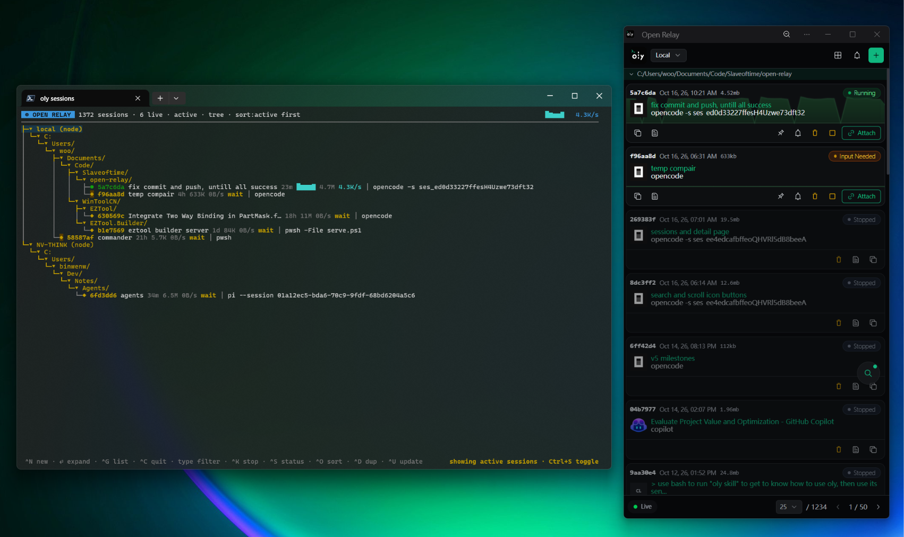
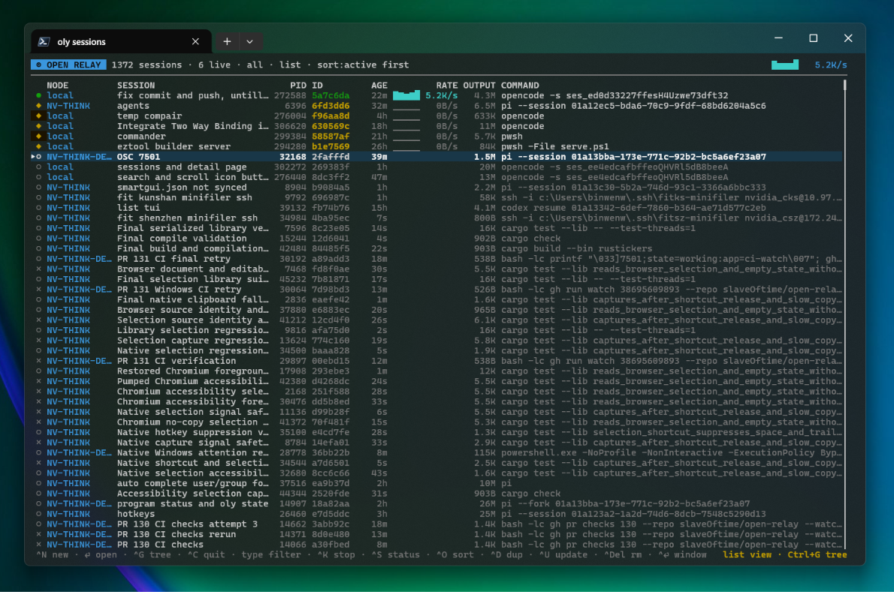
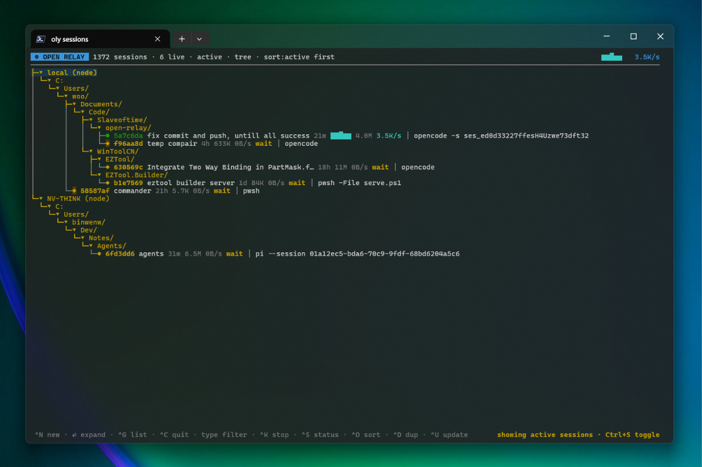
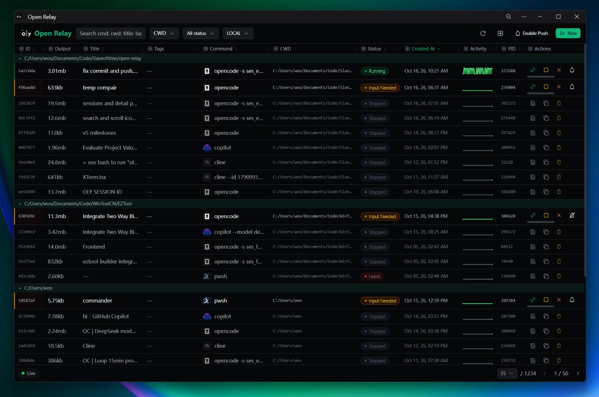
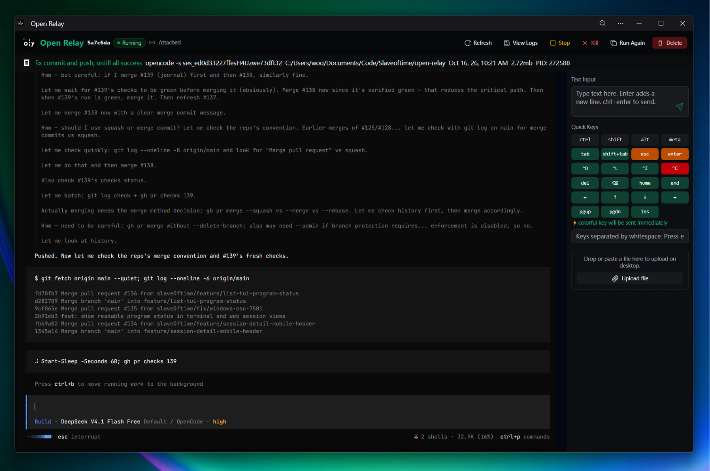
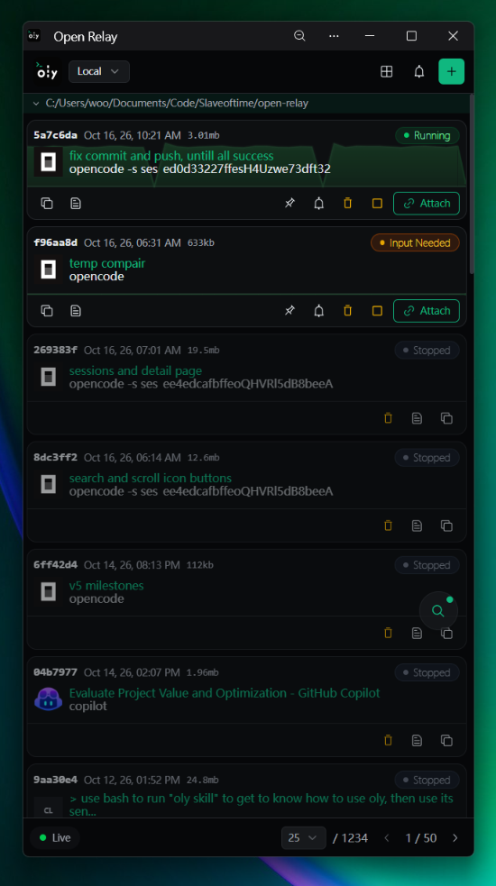
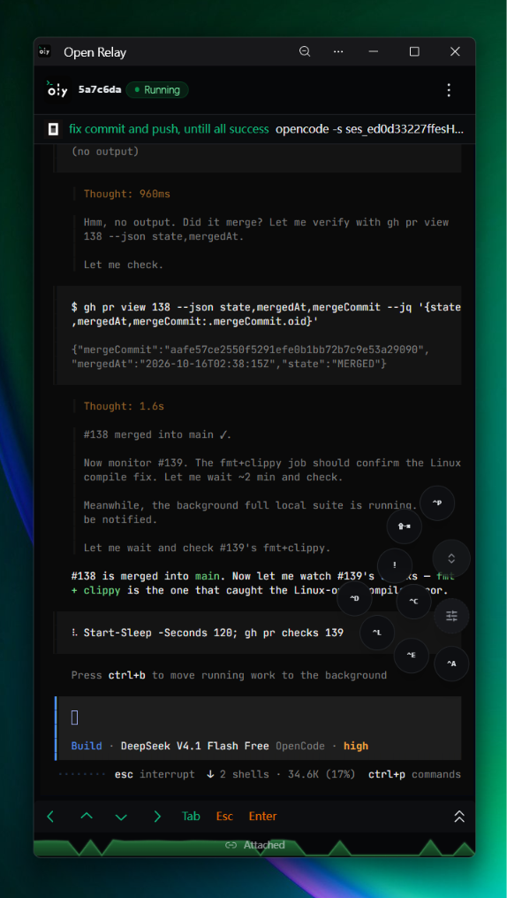

# oly — Open Relay

<p align="center">
  
</p>

<p align="center"><strong>Close your laptop. Your agents keep working. Come back to the one that needs you.</strong></p>

[](https://www.npmjs.com/package/@slaveoftime/oly)
[](https://github.com/slaveOftime/open-relay/blob/main/LICENSE)

<p align="center"></p>

Run an interactive CLI once. Close your terminal. Come back from another
terminal or a browser — with the process still running and its output recorded.

`oly` is a local-first session supervisor for coding agents, REPLs, and
long-running commands that still need a human in the loop. It runs the CLI you
already use — no model-provider integration — and serves both the `oly ls
--follow` dashboard and a password-protected web UI at `http://127.0.0.1:15443`.

## Why oly?

- **Walk away without losing the job.** The daemon owns the PTY, not your terminal.
- **See who needs you.** Lifecycle status and agent-reported [program status](./docs/guides/cli.md#agent-reported-status-osc-7501) roll into one list.
- **Check in, don't babysit.** Read recent output, inspect a live TUI, or wait for a likely input-needed checkpoint.
- **Intervene without attaching.** Send text, keys, or application mouse input; take over interactively when needed.
- **Pick up from anywhere.** Use the terminal or the browser — including your phone — and route work to connected machines.
- **Give agents a reliable control surface.** JSON metadata, bounded byte pages, and resumable cursors support scripted supervision.

Think **persistent terminal sessions + a supervision API**, not another agent
framework. Use your shell for quick commands; use oly when a job needs a durable home.

## See it

**Terminal dashboard** — `oly ls --follow --node-all --limit 5000` lists every session, or groups them by working directory.

| List view | Tree view |
|---|---|
| [](./assets/oly-list-tui.png) | [](./assets/oly-list-tui-tree.png) |

**Browser UI** — the same daemon from any device, with live status and one-click attach.

[](./assets/oly-web-sessions-page.png)

[](./assets/oly-web-detail-page.png)

**On a phone** — the web UI installs as a PWA, so you can check a prompt and answer it without a laptop.

| Sessions | Detail |
|---|---|
| [](./assets/oly-web-sessions-page-mobile.png) | [](./assets/oly-web-detail-page-mobile.png) |

## Install

```sh
npm install -g @slaveoftime/oly
```

The npm package bundles binaries for **Linux x64, Linux arm64, macOS Apple
Silicon, and Windows x64**. No GitHub asset download is needed during
installation.

> **0.5.0 is available.** This is a breaking upgrade from 0.3: back up state and
> read the [migration guide](./docs/releases/migration-0.5.md) before switching.
> See the [release notes and verification](./docs/releases/release-notes-0.5.0.md).

<details>
<summary>Other installation options</summary>

**Homebrew**:

```sh
brew tap slaveOftime/open-relay https://github.com/slaveOftime/open-relay
brew install slaveOftime/open-relay/oly
```

**Prebuilt binaries:** download a platform archive from
[GitHub Releases](https://github.com/slaveOftime/open-relay/releases).

**Cargo**:

```sh
cargo install oly
```

Building from source requires Rust and Node.js/npm: release builds compile and
embed the web UI. See [Contributing](./CONTRIBUTING.md) for development setup.

</details>

## From launch to handoff

```sh
# Start the daemon (skip this if it is already running).
# Default: password-protected web UI at http://127.0.0.1:15443.
oly daemon start --detach

# Run your preferred CLI in the background; save the returned session ID.
oly start --detach copilot

# See sessions and inspect recent output.
oly ls
oly logs <id> --tail 40

# Inspect a TUI and, after reviewing its prompt, reply without attaching.
oly logs <id> --screen
oly send <id> "continue" key:enter

# Take over interactively. Ctrl-D detaches; the child keeps running.
oly attach <id>
```

Replace `copilot` with `claude`, `codex`, another agent, or any interactive
command. Pass oly options **before** the child command.

Open **http://127.0.0.1:15443** for the browser UI, or use
`oly ls --follow --node-all --limit 5000` for the live terminal dashboard.

### A few commands worth remembering

| Want to… | Command |
|---|---|
| Wait for a likely checkpoint | `oly logs <id> --wait prompt --timeout 5m` |
| Inspect metadata and exit status | `oly info <id>` / `oly info <id> --json` |
| Watch without sending input or resizing | `oly attach <id> --observe` |
| Interrupt the child | `oly send <id> key:ctrl+c` |
| Export recorded display bytes | `oly export <id> > capture.bin` |
| Stop a session | `oly stop <id>` |
| Start a fresh run from saved launch metadata | `oly restart <id>` |
| Teach an agent how to supervise sessions | `oly skill` / `oly skill --subagent` |

## Know the boundaries

- **Persistent sessions, not immortal processes.** Closing a client does not stop
  the child. Stopping/crashing the daemon or rebooting the host does; retained
  recordings remain, but live PTYs cannot be recovered. `restart` launches a new run.
- **Hints, not task understanding.** Prompt and idle detection can be wrong.
  Check fresh output and the actual result; successful input delivery is not completion.
- **Shared control, not exclusive ownership.** Multiple attached controllers can
  type concurrently; the last successful resize wins. Coordinate with other users.
- **Local-first, not a sandbox.** Child commands run with the daemon user's
  privileges. Keep HTTP on loopback or put remote access behind a trusted tunnel
  and authentication gateway. View-only mode is not a security boundary.

## Go deeper

- [CLI guide](./docs/guides/cli.md) — logs, cursors, input, scrolling, and session lifecycle
- [Remote access](./docs/guides/remote-access.md) — browser security, `oly node` peer management, and notifications
- [Troubleshooting](./docs/guides/troubleshooting.md) — expected limits, and what to collect when reporting
- [Agent skills](./skills/oly/SKILL.md) — general usage; [sub-agent orchestration](./skills/oly-subagent/SKILL.md), [daemon configuration](./skills/oly-daemon/SKILL.md), [web apps](./skills/oly-apps/SKILL.md)
- [Upgrade to 0.5](./docs/releases/migration-0.5.md) — breaking changes and safe upgrades
- [Architecture](./ARCHITECTURE.md) · [Performance](./PERFORMANCE.md) · [Contributing](./CONTRIBUTING.md)
- [What's new in 0.5](./docs/releases/whats-new-0.5.md) · [Compatibility](./docs/releases/compatibility-0.5.md) · [All documentation](./docs/README.md)

MIT licensed. If oly makes your workflow easier, a
[star on GitHub](https://github.com/slaveOftime/open-relay) helps others find it.
